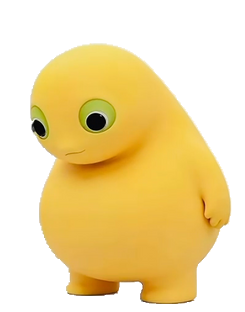

# 小黄桌宠 · XiaoHuang Desktop Pet

一只会跟着鼠标转眼睛、会眨眼、被戳肚子会陷下去、双击会低头啄肚肚的 Windows 桌面宠物。

形象来自 3D 渲染视频（黄色小团子），程序结构沿用 [yugh6](https://github.com/yugh6) 的**奶蛙桌宠**：单文件 C# + WinForms + `UpdateLayeredWindow` 分层窗口，无需安装、无需联网。



## 功能

| 操作 | 效果 |
| --- | --- |
| 待机 | 视频第 16 帧形象，每 4~8 秒自然眨眼（整只眼睛纵向压扁成细缝） |
| 鼠标靠近 | 眼球在眼眶里朝鼠标方向转动（大眼 ±3px、小眼 ±1px，各自独立） |
| 单击肚子 | 肚子凹陷再弹起轻晃，约 1 秒；点其他部位无效 |
| 双击 | **啄肚肚**：低头弯下去 → 趴着 → 倒放抬头 → 站好，约 9.3 秒；结束时自动站起 |
| 拖动 | 随方向轻微倾斜，松手轻弹，记住位置，支持多显示器 |
| 全屏应用 | 自动隐藏，退出全屏后原位恢复 |
| 右键 / 托盘 | 啄肚肚、停止、大小三档、置顶、全屏隐藏、回到右下角、使用说明、退出 |

重复启动不会出现两个实例，而是把已有的小黄叫回鼠标所在屏幕的右下角。

## 运行

1. 把 `小黄桌宠.exe` 和 `素材.nwp` 放在同一个文件夹；
2. 双击 exe（需要 .NET Framework 4.x，Win10/11 自带）；
3. 设置保存在 `%LOCALAPPDATA%\XiaoHuangPet\settings.ini`。

### Linux 版

`Linux版/` 是一份 Python + PyQt6 的移植版，读**同一份 `素材.nwp`**：

```bash
cd Linux版
python3 -m pip install PyQt6
./run.sh
```

支持眨眼、眼球跟随、戳肚子、双击啄肚肚、拖动、托盘菜单、三档大小、置顶。
X11 下功能完整；Wayland 下受安全限制，眼球只在鼠标进入窗口时跟随（详见 `Linux版/README.md`）。

## 文件结构

```
小黄桌宠.exe              编译好的成品（单文件，137 KB）
素材.nwp                  形象素材包（普通 ZIP，15 MB）
使用说明.txt              给用户看的操作说明
README.md                 本文件
源码/
  Naiwa.cs                全部逻辑：Motion 状态机 / Assets 素材 / PetForm 窗口
  AssemblyInfo.cs         程序集信息
  build.cmd               一键编译（调用系统自带 csc.exe）
  pet.ico                 图标
  Pet.manifest            DPI 感知声明
  tools/
    make_assets_3d.py     当前素材生成脚本（眼窝+眼球贴片+眨眼+啄肚肚序列）
    make_assets_3d_plain.py  备用：不做眼球合成，直接用视频原图
形象/                     形象图与预览
预览/                     交互演示 mp4 / gif
Linux版/                  Linux 移植版（Python + PyQt6）
  小黄桌宠.py             主程序
  run.sh                  启动脚本
  README.md               Linux 使用说明
  requirements.txt        依赖（PyQt6）
```

## 从源码编译

```bat
cd 源码
build.cmd
```

脚本直接调用 `C:\Windows\Microsoft.NET\Framework64\v4.0.30319\csc.exe`，不需要 Visual Studio。

## 素材包协议

`素材.nwp` 就是个 ZIP，程序用 `ZipFile.OpenRead` 读取：

```
metadata.json          width height frames fps eyeFrames blinkFrames blinkFps
                       + pupilRange pupilRange2 eyeX eyeY（眼球可动时需要）
look/00.png 01.png     整帧待机（眼球不可动时走这条路径）
base/00.png            眼窝底板：整帧，但眼球位置被填成单色绿
pupil/00.png           大眼眼球贴片（原视频像素，圆形裁切，带自带的高光）
pupil2/00.png          小眼眼球贴片（贴着脸型边缘，位移更小）
blink/0/00..06.png     眨眼帧：整帧，整只眼睛纵向压扁 1.0→0.55→0.22→0.06→回弹
blink/1/...            第二组，代码按视线方向选用
laugh/0000..0279.png   啄肚肚序列：正放 190 帧 + 倒放 84 帧 + 6 帧渐变回待机
```

所有帧必须严格等于 `width × height`，PNG + 透明底；单边 ≤1024px、帧数 ≤2000、fps 1~120。

## 素材是怎么做出来的

1. 视频逐帧抠像（灰色影棚背景）→ 480×428 透明 PNG，30fps；
2. 取第 16 帧作为画布基准，缩放到 241×262 后贴进 245×312 画布；
3. 自动找两只瞳孔的圆心与半径 → 眼窝填成单一绿色、眼球单独裁成圆形贴片；
4. 眨眼帧：用脸颊肤色盖住眼睛，再把整只眼睛纵向压扁；
5. 啄肚肚：正放 190 帧 → 从和末帧姿态一致的帧开始倒放 → 末 6 帧渐变到待机图（消除切回待机时的闪）；
6. 全部打包成 `素材.nwp`。

## 与原版奶蛙桌宠的差异

- 窗口标题 `XiaoHuangDesktop.v1`、互斥体、设置目录都分开，**可以和奶蛙同时运行**；
- 新增 `pupil2` 第二眼球图层与 `pupilRange2`，让贴脸的那只小眼只走 1px；
- 新增 `--laugh` / `--probe` / `--quit` 命令行参数，方便外部程序触发和调试；
- 肚子命中区、变形范围、图标裁剪、旋转支点等常量按新形象重算。

## 版权与致谢

- **程序结构**：来自 [yugh6](https://github.com/yugh6) 的奶蛙桌宠（抖音：握石竹）。本仓库是其修改版，感谢原作者；原项目的形象、音效、素材**均未包含**在本仓库中。
- **形象素材**：由本仓库作者自制（3D 渲染视频 → 抠像 → 处理）。
- 本项目仅供个人学习与自用；请勿搬运冒充原创，请勿用于商业用途。如需公开发布或商用，请先确认上游代码的授权。
